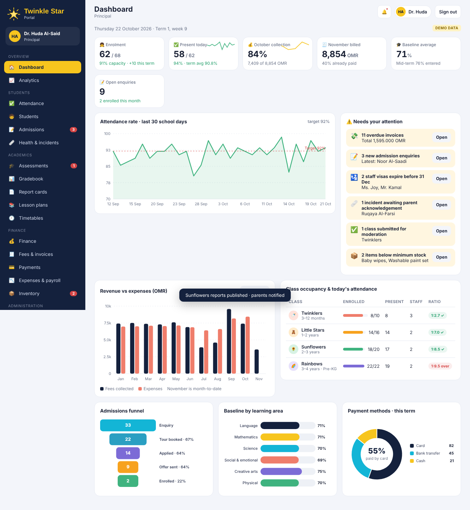
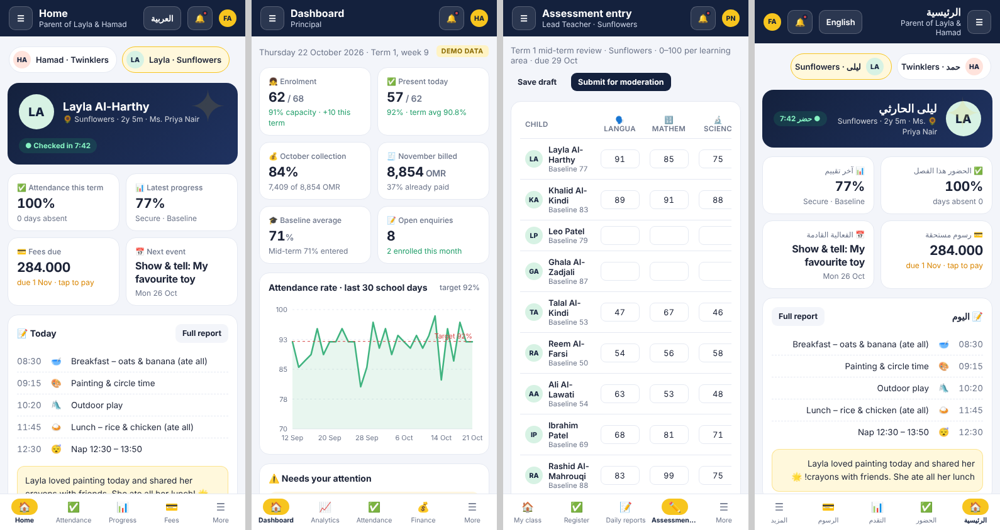
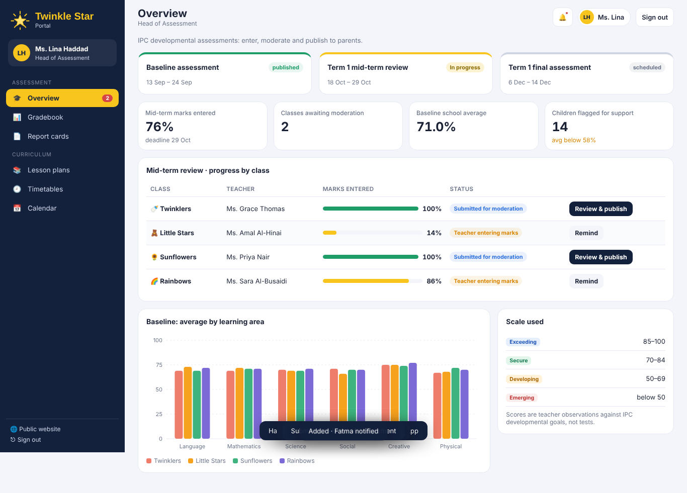
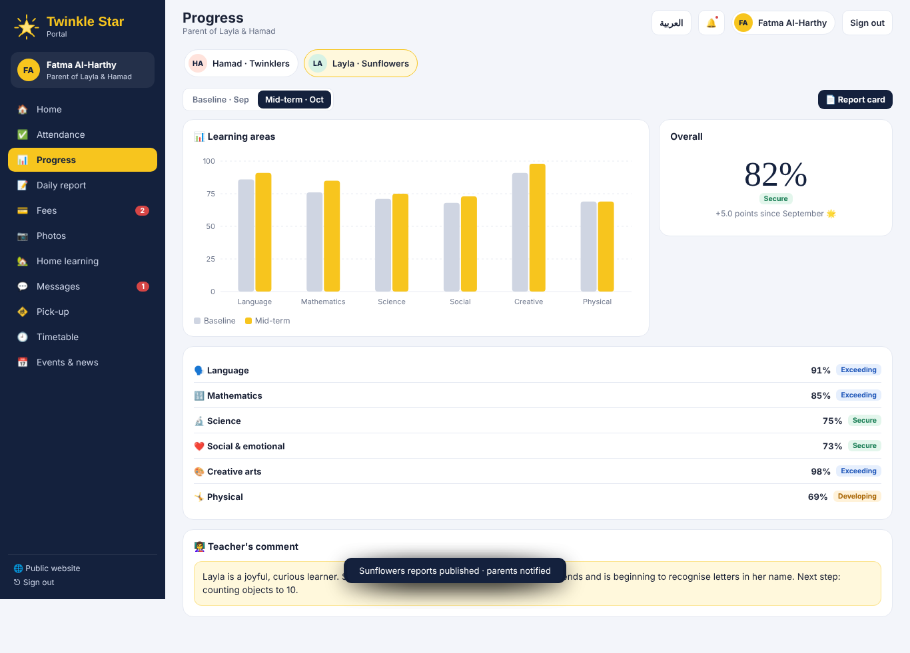

# TwinkleStar International ChildCare: Website & School Portal

A public website and a full, role-based school management portal for **TwinkleStar International ChildCare**, an international nursery (3 months – 4 years) in Al Hail North, Seeb, Muscat, Oman.

> **Status: interactive prototype for presentation.** All portal data is sample data. No real payments are processed. Changes made in the demo are stored only in the viewer's browser.

## What's inside

| File | What it is |
|---|---|
| `index.html` | Public website for parents (built, self-contained) |
| `portal.html` | School portal with six role logins (built, self-contained) |
| `src/` | Editable sources: `site.html`, `portal.html`, `portal.css`, `data.js`, `charts.js`, `app.js`, `views1.js`, `views2.js` |
| `build.py` | Combines `src/` into `index.html` and `portal.html` (`python3 build.py`) |

No frameworks, no build tools beyond Python, no external JS libraries. Charts are hand-written SVG.

## Public website (`index.html`)
Home, About, Programmes (Twinklers, Little Stars, Sunflowers, Rainbows), IPC curriculum, a day at TwinkleStar, facilities, accreditation & recognition, gallery with lightbox, parent-portal preview, admissions (book a visit / enrolment enquiry), FAQ, contact with map, WhatsApp button. Fully responsive.

Website enquiries flow straight into **Admin → Admissions**, and the homepage banner and headline can be edited from **Admin → Website**.

## Portal (`portal.html`): demo logins
Password for all accounts: **`demo123`**

| Username | Role | Highlights |
|---|---|---|
| `principal` | Principal | Sees everything. Dashboard, analytics (attendance, academic, finance, admissions, operations), alerts |
| `admin` | School administrator | Today view, QR check-in kiosk, attendance, absence requests, students, admissions pipeline, incidents, staff & HR, timetables, notices, messaging oversight, notifications log, ID cards, inventory, website editor |
| `accounts` | Accountant | Finance overview, invoices & fee vouchers, record payments, reminders, December invoice run, payments & receipts, expenses, payroll & payslips, inventory, CSV exports |
| `exams` | Head of Assessment | Assessment windows, marks-entry progress, moderation & publishing, gradebook, printable report cards, lesson-plan approval |
| `teacher` | Lead teacher (Sunflowers) | Class dashboard, register, daily reports (meals, naps, nappies, mood, notes), assessment marks entry, lesson plans, home learning, photos, messages, incidents |
| `parent` | Parent of two children | Home, attendance calendar, progress & report cards, daily report, **card fee payment**, receipts, photos, home learning, messages, pick-up pass & approved people, timetable, events. Arabic / English |

Tip: add `#principal`, `#parent` etc. to the URL (e.g. `portal.html#parent`) to sign straight in.

### Suggested demo flow
1. **Website**: book a visit → **Admin → Admissions** shows it instantly.
2. **Teacher**: add a snack to Layla's daily report; complete mid-term marks and submit.
3. **Exams**: review Sunflowers → approve & publish.
4. **Parent**: see the new report and progress chart; pay November fees by card (`4242 4242 4242 4242`).
5. **Principal / Accounts**: payment appears, collection rate updates.

## Going live: what's needed
- Backend & database (e.g. Supabase/Postgres) with real authentication and role permissions
- Licensed Omani payment gateway for card payments (merchant account set up by the nursery)
- WhatsApp Business / SMS provider for notifications
- Hosting + domain; installable mobile app (PWA) from the same pages
- Compliance with Oman's Personal Data Protection Law (children's data and photo consent)

## Screenshots
| Mobile (parent, principal, teacher, Arabic) | Assessment | Parent progress |
|---|---|---|
|  |  |  |

---
Public information about TwinkleStar (contact details, age range, IPC curriculum, American Board award) is taken from the school's listings on omanschoolfinder.com and omaniservices.com and should be confirmed with the school.
